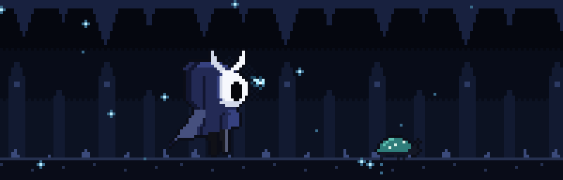
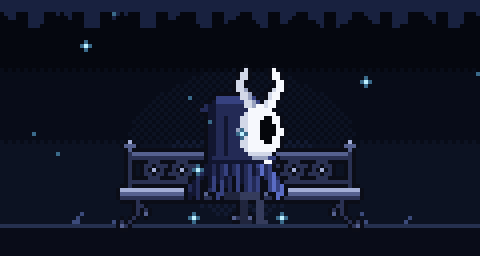

  

### ✦ Le carnet du vagabond

- 🗺️ Je cartographie des projets en ce moment : <b>…</b>
- 🕯️ J'apprends : <b>…</b>
- 🪲 Je chasse les bugs dans : <b>…</b>
- 💬 Me trouver : <b>…</b>

 

### ✦ Arsenal

  

### ✦ Journal des profondeurs

  
  

  

  

<i>Repose-toi un instant, voyageur. Le chemin continue.</i>

