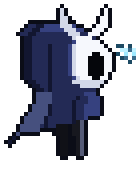

  

### ✦ Le carnet du vagabond

- ⚙️ <b>Automatisation</b> : je construis des chaînes de traitement en Python qui traduisent, corrigent et mettent en page des livres de règles de jeu de rôle.
- 🤖 <b>IA appliquée</b> : j'explore le RAG et les agents, par exemple avec <b>GrimmorBot</b>, un bot Discord qui répond aux questions de règles en pleine partie.
- 🗺️ <b>Outils pour les joueurs</b> : cartes de chronique, sites compagnons pour joueurs et MJ, fiches en ligne.
- 📱 <b>Applis &amp; web</b> : du site statique à l'appli mobile en Flutter, avec une préférence pour les outils qu'on utilise vraiment.

 

### ✦ Arsenal

  

### ✦ Journal des profondeurs

  
  

  

<i>Repose-toi un instant, voyageur. Le chemin continue.</i>

